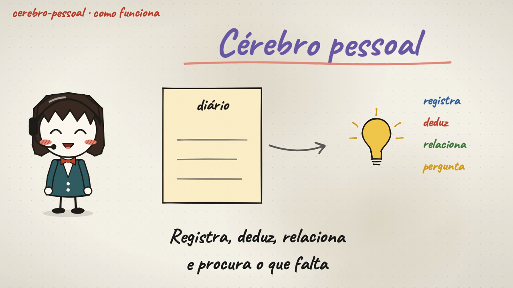
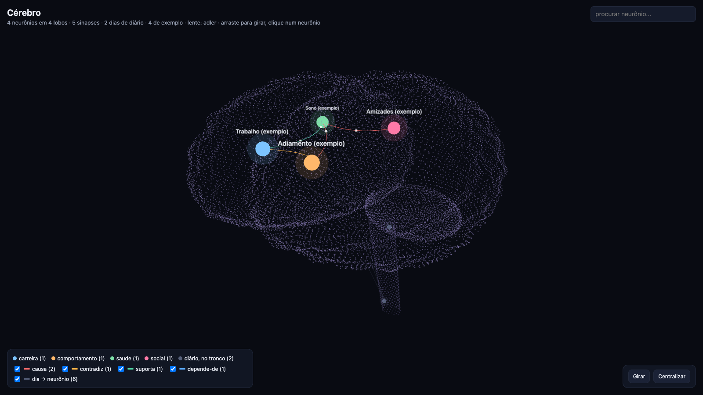
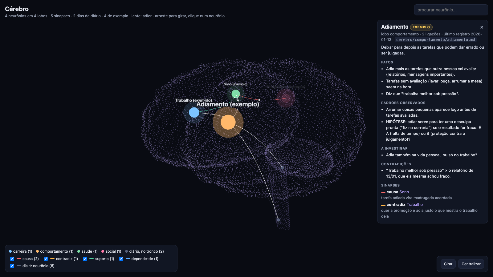

# Cérebro pessoal

[](docs/como-funciona.mp4)

**[▶ Assista ao vídeo: como funciona (~2 min)](docs/como-funciona.mp4)**

Um diário que pensa. Você conta o seu dia a dia para o **ChatGPT (Codex)**, o **Claude (Claude Code)** ou o **Gemini (Antigravity)**, e o Cérebro registra, deduz, relaciona, procura o que está faltando e organiza tudo em **neurônios**: um arquivo por área ou tema da sua vida, ligados por **sinapses** com tipo. Tudo lido por uma lente filosófica que você escolhe (o padrão é a psicologia de Alfred Adler). Depois de um ou dois meses de registros, ele entrega um **diagnóstico** e passa a fazer o papel de **coach**. Vem com um **visualizador 3D**: o seu cérebro em forma de cérebro, girando, com os neurônios dentro, clicáveis.



## Como funciona

```
você conta o dia  →  diário (com hora e as suas frases literais)
                  →  neurônios atualizados (fatos, linha do tempo, padrões)
                  →  sinapses (causa, contradiz, suporta, depende-de, parte-de, instancia, relacionado)
                  →  leitura pela lente + deduções "é A ou B?" + perguntas sobre o que falta
   30–60 dias     →  diagnóstico (núcleo, padrões, pontos fortes, rotas, testes de campo)
   depois         →  coach (um foco por vez, tarefas com prazo, previsão × resultado)
```

- **Fase 1, mapeamento.** Cada conversa segue o mesmo ciclo. O Cérebro não concorda para agradar: aponta quando o que você diz hoje contradiz o que já está registrado, e termina com perguntas, incluindo uma sobre uma área da vida que ainda está em branco.
- **Fase 2, diagnóstico.** Quando o `status` diz que há dado suficiente (padrão: 30 dias, 20 dias com diário, 8 neurônios), ele propõe o diagnóstico: a regra de vida que explica mais padrões, cada padrão com evidência datada e a sua finalidade, os pontos fortes, o que ainda não se sabe, e duas rotas: ajuda profissional e/ou coach prático. É a única hora em que vale usar o modelo mais forte.
- **Fase 3, coach.** Um foco por vez, tarefas concretas com prazo, testes de campo com previsão escrita antes, cobrança gentil e revisão semanal. A análise continua por baixo.
- **Não é terapia.** Em crise ou sofrimento forte, ele sai do papel de coach e indica ajuda (no Brasil, CVV 188).

### Os arquivos

```
AGENTS.md              regras (fonte única). O Codex e o Antigravity leem este arquivo.
CLAUDE.md / GEMINI.md  importam o AGENTS.md + notas de cada ferramenta
config/cerebro.json    lente, fase, critérios do diagnóstico, áreas da vida, palavras-código, "onboarding_feito"
cerebro/
  INDEX.md             índice gerado (um neurônio por linha)
  _graph.md            todas as sinapses, gerado
  diario/AAAA-MM-DD.md episódios do dia
  <lobo>/<neuronio>.md os neurônios (ex.: saude/sono.md)
analises/              diagnósticos
dump/                  caixa de entrada: jogue arquivos aqui e diga "dump"
guias/                 ONBOARDING, METODO, DIAGNOSTICO, COACH, MODELOS-E-CUSTOS, lentes/, capacidades/
ferramentas/cerebro.py status, checagem de sinapses, índice, grafo, dados do visualizador
visualizador/index.html  o cérebro 3D
abrir-cerebro.command  Mac  ·  abrir-cerebro.bat  Windows  ·  abrir-cerebro.sh  Linux
```

**Neurônio** (formato completo em [`guias/METODO.md`](guias/METODO.md)): `## Fatos`, `## Linha do tempo` (datada, mais recente no topo), `## Padrões observados`, `## A investigar`, `## Contradições` e `## Sinapses`, no formato `- [[lobo/arquivo]] — **tipo** — motivo`. Toda sinapse existe nos dois lados; o `cerebro.py checar` acha as que faltam. A pasta `cerebro/` também abre no Obsidian.

**Exemplos.** O repositório vem com 4 neurônios e 2 dias de diário **fictícios**, marcados `EXEMPLO`, para você ver o formato e o visualizador. No onboarding o Cérebro pergunta se pode apagá-los (`python3 ferramentas/cerebro.py limpar-exemplos`).

## O visualizador 3D

Dois cliques em `abrir-cerebro.command` (Mac), `abrir-cerebro.bat` (Windows) ou `./abrir-cerebro.sh` (Linux). O launcher roda `ferramentas/cerebro.py visual` (lê os neurônios e gera `visualizador/dados.js`) e abre `visualizador/index.html` no navegador. Não precisa de servidor; se o seu navegador bloquear arquivo local, use `--servidor` (sobe `python3 -m http.server` só no seu computador).

- O cérebro gira; arraste para girar, role para aproximar.
- Cada bolinha é um neurônio, colorido pelo lobo e maior quanto mais ligado. Os dias do diário ficam no tronco.
- Clique num neurônio: aparecem os fatos, os padrões, as contradições e as sinapses (clicáveis).
- Os pontinhos brancos correndo nas linhas são só enfeite: sinais passando pelas sinapses.
- Usa o three.js 0.147.0 do jsDelivr (precisa de internet na primeira vez). No Mac, na primeira vez, clique com o botão direito no `.command` > Abrir.



## Requisitos

- Uma das três ferramentas: **ChatGPT Plus** com Codex (recomendado), **Claude Pro** com Claude Code, ou **Gemini** pelo Antigravity CLI.
- **Python 3** (para o `cerebro.py` e o visualizador). Só biblioteca padrão.
- Um navegador com WebGL (qualquer um atual).
- `git` para clonar.

## Começar

```bash
git clone https://github.com/hackermannjon/cerebro-pessoal.git meu-cerebro
cd meu-cerebro
```

Abra a pasta na sua ferramenta e diga "oi". O Cérebro começa o onboarding sozinho: se apresenta, explica o método, e pergunta como te chamar, a lente, as áreas da vida, palavras-código para temas íntimos, o ritmo, o modelo e as capacidades opcionais (voz, lembrete diário, vários computadores, backup). Tudo em texto, na própria conversa. Depois: "me conta como foi o seu dia".

- **ChatGPT / Codex (recomendado):** app desktop do ChatGPT no modo Codex, abrindo a pasta como projeto; ou o Codex CLI (`codex` na pasta). [Instalação](https://learn.chatgpt.com/docs/cli).
- **Claude Code:** `claude` na pasta. O repositório já fixa o Sonnet; o Opus fica para o diagnóstico.
- **Gemini:** `agy` na pasta (Antigravity CLI). O Gemini CLI antigo lê o `GEMINI.md`.

Diferenças entre as ferramentas, limites, fontes e economia de contexto: [`guias/MODELOS-E-CUSTOS.md`](guias/MODELOS-E-CUSTOS.md).

## Custos e modelos (resumo)

Consultado em 20/11/2026.

| | Conversa do dia | Diagnóstico (1x a cada 1–2 meses) | Ver consumo |
|---|---|---|---|
| ChatGPT Plus (Codex) | GPT-6.2 Sol, esforço baixo/médio | GPT-6.2 Astra | `/status` |
| Claude Pro (Claude Code) | Sonnet | Opus | `/usage` |
| Gemini (Antigravity) | Gemini Flash | Gemini Pro (Neon) | `/usage` |

- Uma conversa do Cérebro custa mais que um chat comum, porque ele lê e escreve arquivos. Conte com uma conversa média por dia.
- O `cerebro.py status` existe para economizar: em vez de abrir a pasta inteira, o Cérebro lê um resumo de 5 linhas e o índice, e abre só os neurônios do assunto.
- Modelo forte só no diagnóstico. Nunca em rotina.

## Como personalizar

- **Pedindo:** "muda a lente para estoicismo", "quero um lembrete às 22h", "cria um neurônio sobre X", "refaz o onboarding".
- **Editando:** `config/cerebro.json` (lente, critérios do diagnóstico, áreas da vida, palavras-código); `AGENTS.md` (regras); `guias/lentes/` (crie a sua lente no mesmo formato); `guias/DIAGNOSTICO.md` e `guias/COACH.md` (como as fases funcionam).

## Privacidade

O cérebro é íntimo. Se for guardar a sua cópia no GitHub, **o repositório tem que ser privado**. O `visualizador/dados.js` (gerado a partir dos seus neurônios) fica fora do git de propósito. Para temas que você não quer ver escritos por extenso, combine palavras-código no onboarding.

## Licença

[MIT](LICENSE).
